# Hey, I'm Oana 👋

**Senior Software Engineer | Full-Stack | React, Node.js & TypeScript**

I build things for the web, and I care about what happens after they ship.

I'm a full-stack engineer with 7+ years of experience turning complex requirements into reliable, maintainable software. I've worked on everything from enterprise platforms serving millions of users to SaaS products, payment systems, and developer tools.

I enjoy the tricky parts: untangling complex problems, making architecture decisions, finding bugs that refuse to make sense, and turning messy requirements into something that just works.

I believe good engineering is about more than writing code. It's about asking the right questions, keeping things simple where possible, and building software that other developers actually enjoy working with.

### ⚡ What I work with

- **Frontend:** React, Angular, TypeScript, React Native, Storybook
- **Backend:** Node.js, Fastify, Express, tRPC, REST, GraphQL
- **Data:** MongoDB, PostgreSQL, Redis
- **Cloud & DevOps:** GCP, AWS, Docker, Terraform, CI/CD
- **Integrations:** Stripe, Salesforce, and third-party APIs
- **Quality:** Testing, monitoring, accessibility, and performance

### 🚀 A few things I've worked on

- Built enterprise applications and micro-frontend architectures at ZoomInfo, supporting products used by millions.
- Developed payment integrations and reliability workflows involving Stripe, asynchronous processing, and cloud services.
- Designed and shipped dashboard experiences and reusable UI components.
- Built monitoring and alerting tools to make production systems easier to understand and maintain.
- Taken features from initial design through development, deployment, and everything that comes afterward.

### 🧩 A little more about how I work

I like clean architecture, thoughtful UI, and solving problems at their root rather than patching symptoms.

I'm equally comfortable building a React interface, digging into backend services, or figuring out why something that worked perfectly yesterday suddenly doesn't.

And yes, I will probably refactor that unnecessarily complicated function. 🙂

### 📌 Things I've built

| Project | What it's about | Live |
|---|---|---|
| [Pokédex Monorepo](https://github.com/GoldbergOanna/pokedex-monorepo) | Full-stack TypeScript, shared types, authentication, and PostgreSQL | — |
| [UV Bunny](https://github.com/GoldbergOanna/uvbunny-app) | Angular 19, Firebase, and real-time application development | [▶ Live demo](https://uvbunny-app.web.app) |
| [React Canvas Platformer](https://github.com/GoldbergOanna/react-canvas-platformer) | Game loops, physics, and React working alongside HTML5 Canvas | [▶ Play it](https://react-canvas-platformer.web.app) |

### ☕ Let's connect

I'm open to interesting freelance projects, collaborations, and conversations about software engineering.

Have something you're building or a particularly stubborn technical problem?

Find me on [LinkedIn](https://www.linkedin.com/in/goldbergoana) or reach out at **goldbergoanna@gmail.com**.

