## Hi, I'm Oana

I'm a senior full-stack engineer at **AccessiBe** with **7+ years** of experience building production web platforms, from enterprise apps serving millions of users to SaaS billing, licensing and admin systems.

🌍 **I work remotely from anywhere.** 

I own features end to end: design, build, rollout, and the fixes that come after launch.

**I'm taking on freelance and contract projects.** Here's what I can help with:

- 🚀 **Full-stack web apps:** React or Angular frontends with Node.js/TypeScript backends, from MVP to production
- 💳 **Payments and integrations:** Stripe (billing, webhooks, Connect), Salesforce, Jira, SendGrid, and third-party APIs
- 🎨 **Design systems and UI:** reusable component libraries, Storybook, and accessible, responsive interfaces
- ☁️ **Cloud and reliability:** GCP Cloud Run, Docker, CI/CD, monitoring dashboards, and performance tuning
- 🔍 **Rescue and debugging:** tracing hard bugs across services, finding the root cause, and fixing it for good

## 🛠️ Tech Stack

   
   
  

| Area | What I use |
|---|---|
| **Frontend** | React, Angular, React Native, TypeScript, react-query, Redux, Zustand, NgRx/RxJS, styled-components, Storybook |
| **Backend** | Node.js, Express, Fastify, tRPC, REST, GraphQL, Zod, microservices |
| **Data** | MongoDB/Mongoose, PostgreSQL, Redis, MySQL |
| **Cloud and DevOps** | GCP (Cloud Run), AWS, Terraform, Docker, CircleCI, Jenkins, Cloudflare |
| **Integrations** | Stripe, Salesforce, Jira, LaunchDarkly, SendGrid, Mixpanel, Google Sign-In |
| **Quality** | Jest, Vitest, React Testing Library, Datadog, GCP Monitoring, accessibility (a11y) |

## 💼 Highlights

- Built **micro-frontend architectures** and data-heavy enterprise apps at ZoomInfo, used by millions of users worldwide
- Own **payment reliability** at AccessiBe: Stripe sync at scale, async Cloud Run jobs, 3DS and failed-payment analysis, and idempotent design
- Designed and shipped AccessiBe's **new dashboard navigation system**, accessible from the start, rolled out behind feature flags
- Built **reusable component libraries and Storybook design systems** used by multiple teams
- Set up **monitoring and alerting dashboards** (GCP, Datadog) to improve production visibility

## 📌 Featured Projects

| Project | Stack | What it shows |
|---|---|---|
| [pokedex-monorepo](https://github.com/GoldbergOanna/pokedex-monorepo) | TypeScript, monorepo | Full-stack monorepo structure |
| [uvbunny-app](https://github.com/GoldbergOanna/uvbunny-app) | Angular 19, Firebase | Modern Angular with a realtime backend |
| [react-canvas-platformer](https://github.com/GoldbergOanna/react-canvas-platformer) | React, HTML5 Canvas | Game loop and physics, with declarative UI kept separate from imperative rendering |

## 🤝 Let's work together

Need a feature built, a product taken from idea to launch, or a production bug finally fixed? **[Message me on LinkedIn](https://www.linkedin.com/in/goldbergoana)** or **[email me](mailto:goldbergoanna@gmail.com)**.

